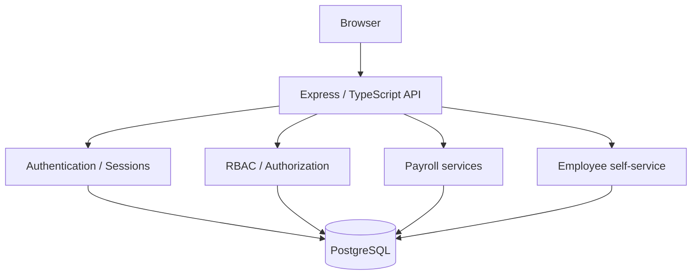

# Architecture

A single Node process serves a static page and a JSON API. PostgreSQL holds users, roles, employees, and the payroll run.

## System context



The browser is `public/index.html`, `public/app.js`, and `public/styles.css`. There is no frontend build step. Express serves those files and the `/api` routes from `src/app.ts`.

Payroll arithmetic lives in `src/services/payrollCalculator.ts`. Run transitions live in `src/services/payrollWorkflow.ts`. Routes call those functions after the auth middleware.

## Request flow

`POST /api/payroll-runs/:id/generate` is representative.

1. The request arrives at `payrollRouter` in `src/routes/payroll.ts`.
2. `requireAuth` reads the `demo_session` cookie, hashes the token, and loads the user from `sessions` joined to `users` and `user_roles`. A missing or expired session returns 401.
3. `requireRole('payroll_processor')` checks the roles just loaded from the database. Any other role returns 403. The request body is not consulted for a role.
4. `generateDraftPayslips` loads the payroll run. A closed run returns 409. If payslips already exist, it returns 409. Otherwise it inserts one `draft` payslip per active employee, using unpaid leave days inside the period and allowances for that run.
5. PostgreSQL commits those inserts.
6. The route returns 201 and `{ "created": <count> }`.

Finalise and close follow the same shape: session, role, then `finalisePayslip` or `closePayrollRun`.

`GET /api/my/payslips/:id` is the record-level example.

1. The request arrives at `selfServiceRouter` in `src/routes/selfService.ts`.
2. `requireAuth` loads the session user, including `users.employee_id`. No session returns 401.
3. `requireRole('employee')` returns 403 for viewer, processor, and closer. Payroll administration routes do the reverse: they do not list `employee`, so an employee who calls generate, finalise, or close receives 403.
4. The handler reads `req.user.employeeId`. It does not read an employee id from the query string or body.
5. The payslip query requires both the path id and that employee id.
6. A matching row is returned as JSON. No row returns 404. That covers an unknown id and another employee's payslip with the same response, so the caller is not told whether the other row exists.

## Authorization

Two checks are separate.

### Role authorization

`requireRole` decides which operations a session may call: generate and finalise for `payroll_processor`, close for `payroll_closer`, payroll reads for the three payroll roles, and `/api/my/...` for `employee`.

### Record-level authorization

Role is not enough for a payslip. `users.employee_id` is set in the database when the fictional employee users are seeded. Alex Morgan's session is linked to employee `E-1001`. Jamie Lee's session is linked to `E-1002`. Profile and payslip queries filter on that stored id. The browser cannot substitute the other employee's id and have the query follow it.

## Data model

| Entity | Role in the demo |
| --- | --- |
| `users` | Fictional people who can sign in. `employee_id` is set only for the two employee sign-ins. |
| `roles` | `payroll_viewer`, `payroll_processor`, `payroll_closer`, `employee`. |
| `user_roles` | Which user has which role. The seed assigns one role each. |
| `employees` | People being paid. Two of them are linked from `users.employee_id`. The other three have no sign-in. |
| `payroll_runs` | One fortnight, `open` or `closed`. |
| `leave_entries` | Unpaid leave days, linked to an employee. |
| `allowances` | A flat amount for one employee on one run. |
| `payslips` | One row per employee per run: gross, leave deduction, allowances, net, `draft` or `final`. |
| `sessions` | Hash of the opaque cookie token, user id, and expiry. |

A payslip belongs to one run and one employee. Leave belongs to an employee and is counted when its date falls inside the run. An allowance belongs to both an employee and a run. A session belongs to a user. Roles are reached only through `user_roles`. An employee sign-in reaches one employee through `users.employee_id`, not through a matching email.

## State model

```text
Open
  |
  v
Generate payslips
  |
  v
Draft payslips
  |
  v
Finalised payslips
  |
  v
Closed payroll run
```

Constraints enforced by the API:

- Only `payroll_processor` can generate or finalise.
- Generate runs once. A second generate on the same run returns 409.
- Finalise changes one `draft` payslip to `final`. An already final payslip returns 409.
- Only `payroll_closer` can close. A processor receives 403 even after every payslip is final, because the role check runs before the workflow check.
- Close returns 409 while any payslip is still `draft`, and when the run has no payslips yet.
- A closed run rejects generate and finalise with 409. Closing it again returns 409.
