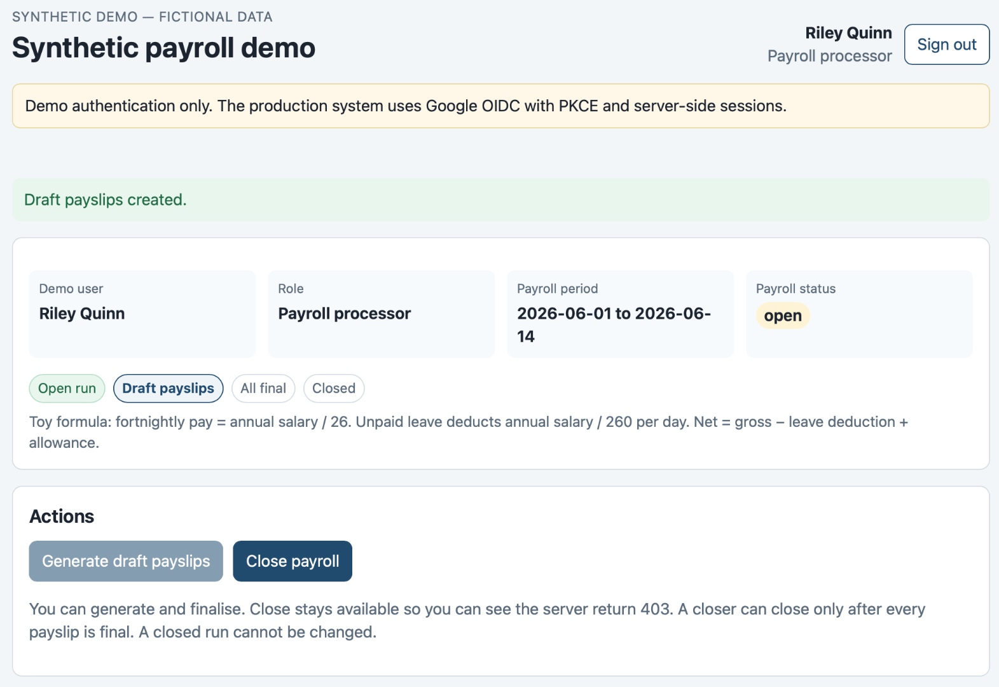
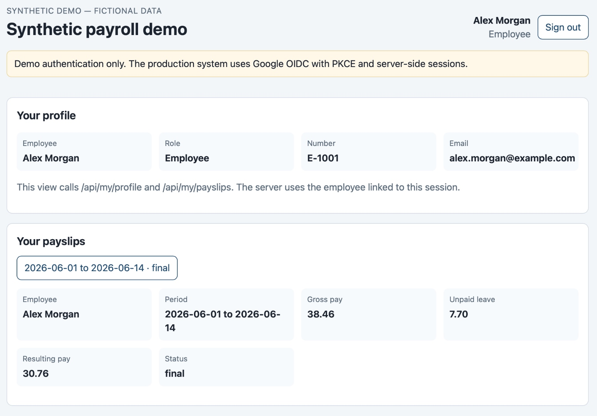
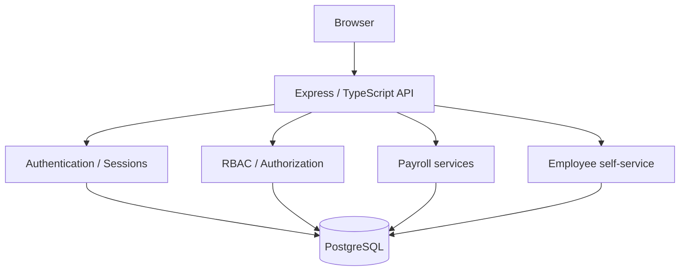

# Synthetic payroll demo

A working payroll slice for a technical review: open a fortnight, generate payslips, finalise them, and close the run under a different role. An employee sign-in can read only that person's own payslip. Every employee, sign-in, salary, allowance, and leave day here is fictional.

## Demo preview

### Payroll preparation



Fictional payroll run after draft generation. The processor prepares
and finalises payslips; a separate authorised role closes the run.

### Employee self-service



Employee self-service after finalisation, showing the fictional
employee's profile and payslip.

See [the five-minute walkthrough](DEMO.md) for the complete workflow,
including draft payslips and authorisation checks.

## Production context and this demo

I designed and deployed a payroll application for a school supporting approximately 125 employees, four administrative users, and around 50 employee self-service users.

The original payroll process relied on copying a large spreadsheet each fortnight and manually adjusting salaries for leave, overtime, salary advances, loan deductions, reimbursements, allowances, class coverage, and complex holiday-pay arrangements. Administrators then prepared cash-payment totals, bank-transfer instructions, and monthly tax and social-security reporting. Payroll information was manually entered into accounting records, while payslips were individually exported and emailed or printed and cut out for distribution.

The problem was broader than calculating pay. The process was labour-intensive, difficult to audit, and dependent on knowledge held largely by one administrator who had maintained it for 16 years. Limited built-in checks created room for human error, while fortnightly payroll had to be reconciled with monthly statutory reporting deadlines. The original brief also identified late-payment penalties as an existing operational concern.

A replacement needed to fit the school's working practices, not simply introduce more automation. Available packages were considered insufficiently customisable, and previous system changes had taken time for staff to adopt. Cash payments, printed payslips, different employee categories, and organisation-specific pay arrangements remained practical requirements. The design challenge was therefore to improve control and usability without forcing an abrupt change to how staff worked.

The production application, employee data, organisation-specific payroll rules, and operational configuration remain private. This repository is a separate, fictional vertical slice, not a copy of that system. It demonstrates selected engineering concerns: explicit payroll state transitions, separation of duties between preparation and closure, server-side authorisation, employee-level data isolation, repeatable database setup, and automated tests.

The demo deliberately substitutes a simplified pay formula and local sign-in picker for the production calculation and Google identity integration. These substitutions let a reviewer exercise the workflow and inspect its trust boundaries without access to real staff information, production payroll rules, identity infrastructure, or cloud resources.

The detailed comparison is in [PRODUCTION-VS-DEMO.md](PRODUCTION-VS-DEMO.md).

## What this demonstrates

- A payroll workflow with explicit state transitions
- Server-side sessions and role checks
- Separation of duties between preparing pay and closing the run
- Employee self-service limited to one linked employee record
- Record-level isolation, tested by requesting another employee's payslip
- Automated tests around the formula, the roles, and the close rules

The point is the path from a business requirement to a tested application: scope, architecture, server-side authorisation, and a page a reviewer can operate.

## My role

The author designed and deployed the production system, and owned the requirements, workflow, scope, architecture, authorization model, database shape, test strategy, review, and acceptance for this demo.

AI-assisted tools drafted and revised implementation. They did not choose the slice or accept the result.

## Demo architecture



The browser is plain HTML, CSS, and JavaScript. Express serves that page and the JSON API. Detail: [ARCHITECTURE.md](ARCHITECTURE.md). Decisions: [DECISIONS.md](DECISIONS.md).

## Technology

Node.js 22, TypeScript, Express 4, PostgreSQL 16, SQL migrations, Jest, Docker Compose. No frontend framework.

## Security / authorization

Sign-in posts a user id. The browser does not send a role. `requireAuth` loads the user from the `demo_session` cookie. Roles and `users.employee_id` come from PostgreSQL on each request.

This login is for the public demo. It is not production identity management.

### Role-level authorization

The role decides which operation is allowed.

| Role | Read payroll admin data | Generate and finalise | Close |
| --- | --- | --- | --- |
| Payroll viewer | Yes | No | No |
| Payroll processor | Yes | Yes | No |
| Payroll closer | Yes | No | Yes, after every payslip is final |
| Employee | No | No | No |

A processor who has finalised every payslip still receives **403** on close. The role check runs before the workflow check.

| Situation | Response |
| --- | --- |
| No session | 401 |
| Signed in, role not allowed | 403 |
| Rule failed, such as drafts remaining or a closed run | 409 |

A closed run rejects generate and finalise with `Closed payroll cannot be modified`.

### Record-level authorization

The employee role only means "may open self-service." Which payslip they may read comes from `users.employee_id` on the session user.

`GET /api/my/profile`, `GET /api/my/payslips`, and `GET /api/my/payslips/:id` ignore any employee id in the query or body. A payslip that belongs to someone else returns **404**, the same body as an unknown id.

Toy formula, rounded to cents. Seed salaries are 1000, 2000, and 3000.

```text
fortnightly base pay = annual salary / 26
daily rate           = annual salary / 260
leave deduction      = daily rate × unpaid days in the period
net pay              = fortnightly base pay − leave deduction + allowances
```

## Running locally

Node.js 22 is declared in `package.json` (`engines`), `.nvmrc`, and the image `node:22-bookworm-slim`.

Compose is the setup that does not depend on the host Node version. It migrates, seeds, and serves the app. The database password in `docker-compose.yml` is `demo_local_password`. That value is fictional and local-only. It is not a production secret. Compose does not read it from the environment. `.env` is for host commands and is gitignored. Copy it from [.env.example](.env.example).

```bash
cp .env.example .env
docker compose up --build
```

Open http://127.0.0.1:3010

To run tests or the TypeScript on the host, use Node 22. This path needs `.env`, because Compose does not create it:

```bash
cp .env.example .env
docker compose up -d db
npm install
npm run migrate
npm run seed
npm test
npm run build
npm run dev
```

`npm run dev` listens on port 3010. `npm run seed:reset` restores the open fortnight with no payslips. API tests use a separate database, `payroll_demo_test`, on the same server.

## Demo identities

| Sign in as | Email | What they can do |
| --- | --- | --- |
| Riley Quinn | processor@example.com | Generate and finalise |
| Jordan Hale | closer@example.com | Close, after every payslip is final |
| Avery Brooks | viewer@example.com | Read the run |
| Employee — Alex Morgan | alex.employee@example.com | Own profile and payslip only |
| Employee — Jamie Lee | jamie.employee@example.com | Own profile and payslip only |

Alex is employee `E-1001`. Jamie is `E-1002`. The other three employees have no sign-in.

## Demo workflow

1. Sign in as Riley Quinn. The run for 1–14 June 2026 is open.
2. Generate payslips, then finalise each one.
3. Choose **Close payroll**. The server returns 403.
4. Sign in as Jordan Hale and close the run.
5. Sign in as Avery Brooks and read the closed run.
6. Sign in as **Employee — Alex Morgan**. The page shows Alex's payslip only.
7. Request Jamie's payslip id as Alex. The API returns 404.

The timed script is [DEMO.md](DEMO.md).

## Testing

Jest and ts-jest. Eighteen tests, in two files:

- `tests/payrollCalculator.test.ts` — fortnightly base, unpaid leave, allowance, cent rounding.
- `tests/api.test.ts` — 401 without a session; viewer read; viewer cannot generate; processor cannot close; generate, finalise, and close; close blocked while a draft remains; a closed run cannot be generated or finalised again; employee own profile, list, and payslip; another employee's payslip returns 404; an employee cannot generate, finalise, or close.

No coverage percentage is claimed.

## AI-assisted development

Perplexity was used to help write detailed engineering prompts. Cursor was the coding environment for implementation and revision.

The developer owned requirements, workflow, scope, architecture, authorization, the database shape, the test strategy, review, and acceptance. [AI-DEVELOPMENT.md](AI-DEVELOPMENT.md).

## What is deliberately absent

Tax, jurisdiction-specific pay rules, payments, PDF payslips, Google OIDC, Google Cloud deployment, employee administration, and any production data or assets.

## Documentation

| Document | Contents |
| --- | --- |
| [ARCHITECTURE.md](ARCHITECTURE.md) | Request flow, both authorization checks, data model, state |
| [DECISIONS.md](DECISIONS.md) | Why the slice, stack, sessions, roles, and record scope |
| [AI-DEVELOPMENT.md](AI-DEVELOPMENT.md) | What the developer owned, and what the tools did |
| [PRODUCTION-VS-DEMO.md](PRODUCTION-VS-DEMO.md) | What was left out, and why |
| [DEMO.md](DEMO.md) | Five-minute walkthrough |
